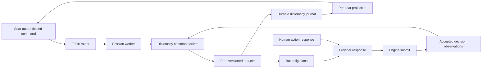

# Multiplayer diplomacy and deals integration

Status: Research and proposed implementation plan. No multiplayer or diplomacy approval is implied.

Date: 2026-10-27

This extends [multiplayer tables](multiplayer-tables.md), proposed in
[ADR 0031](../decisions/0031-multiplayer-tables.md), and the
[server-computed presentation track](server-computed-presentation.md). It compares that work with
the diplomacy implementation on `claude/happy-cori-fe78h7`.

[Table diplomacy and communication](table-diplomacy-and-communication.md) specifies the terms,
offer/answer experience, automatic releases, feasibility/expiry clarification and adversarial
evaluation gates independently. This document owns how that design joins the session and
multiplayer milestones. The [standalone reviews](../reviews/multiplayer-and-deals-plan-review-2026-10-27.md)
record the subsequent source-plan improvements.

## Recommendation

Keep multiplayer and diplomacy as independently usable features. Build one game-local diplomacy
coordinator owned by the session (inside its worker for tables), with typed commands, a serializable
reducer, and recorded inputs.
Use it for spectator, single-player and table games. Deals influence bot choices and describe
human promises; they never change which actions the rules engine permits.

The first table release can ship with diplomacy disabled. Enabling diplomacy for humans requires
the reducer, asynchronous offer lifecycle, clock rules and privacy checks below. It does not
require LLM seats, general chat, accounts or matchmaking. Existing approval and exposure gates in
the multiplayer plan remain in force.

## Research baseline

Reviewed main at `4888fa39277401d5fb1dfb14fded034c6243adb4` and the deals branch at
`b4f5f16e9b27b0356f637e0c6d9a451fc6d3afba`. These are research snapshots, not a claim that the
branches have been merged or their tests have passed in this session.

| Area                 | Evidence                                                                                                                                                                                                                                                                                                   | Integration consequence                                                                                                                                                    |
| -------------------- | ---------------------------------------------------------------------------------------------------------------------------------------------------------------------------------------------------------------------------------------------------------------------------------------------------------- | -------------------------------------------------------------------------------------------------------------------------------------------------------------------------- |
| Multiplayer          | Main's [ADR 0031](../decisions/0031-multiplayer-tables.md) and [plan](multiplayer-tables.md) are proposed. M1 refactors seat controllers; M2 hardens disclosure and RNG; M3 introduces worker-backed tables; M4 adds clocks; M5 gates exposure; M6 adds the browser.                                       | Build on those boundaries; do not extend the tester's WebSocket server into a remote table service.                                                                        |
| Deals contract       | Branch [shared diplomacy types](https://github.com/paulliy/mtgtester/blob/b4f5f16e9b27b0356f637e0c6d9a451fc6d3afba/packages/shared/src/diplomacy.ts) and [deals ADR](https://github.com/paulliy/mtgtester/blob/b4f5f16e9b27b0356f637e0c6d9a451fc6d3afba/docs/decisions/0031-table-diplomacy-and-deals.md). | Reuse structured seat-only obligations and public template messages. Preserve intentional breaking, releases, cooldowns and trust rules.                                   |
| Current driver       | Branch [table.ts](https://github.com/paulliy/mtgtester/blob/b4f5f16e9b27b0356f637e0c6d9a451fc6d3afba/packages/bot/src/diplomacy/table.ts), especially options, private fields, `offer` and `activate`. Humans currently do not negotiate; answers are synchronous.                                         | An async wrapper around a human action provider does not implement human negotiation. Add pending offers and explicit answer commands.                                     |
| Existing integration | Branch [diplomacy-game.ts](https://github.com/paulliy/mtgtester/blob/b4f5f16e9b27b0356f637e0c6d9a451fc6d3afba/packages/server/src/cli/diplomacy-game.ts) and [provider wrappers](https://github.com/paulliy/mtgtester/blob/b4f5f16e9b27b0356f637e0c6d9a451fc6d3afba/packages/bot/src/diplomacy/index.ts).  | The sweep already wires every seat through one table. Production integration belongs in the runner/session, rather than wrapping each fallback and provider independently. |
| Replay               | Deals ADR decision 22 explicitly requires event sourcing before Phase 2. Current private maps, sets, callbacks and held attacks cannot be serialized as a durable state.                                                                                                                                   | Persist negotiation inputs and outcomes separately from engine decisions; browser reconnect and server restart recovery are distinct promises.                             |
| Compliance           | Branch [compliance.ts](https://github.com/paulliy/mtgtester/blob/b4f5f16e9b27b0356f637e0c6d9a451fc6d3afba/packages/bot/src/diplomacy/compliance.ts) uses controller lookup and excludes `chooseAttackers` declarations.                                                                                    | Resolve ownership wording and the acknowledged Master Warcraft chooser gap before claiming these obligations work for human tables.                                        |
| Randomness           | Branch [value.ts](https://github.com/paulliy/mtgtester/blob/b4f5f16e9b27b0356f637e0c6d9a451fc6d3afba/packages/bot/src/diplomacy/value.ts) derives threshold noise from seed, deal id and seat.                                                                                                             | Table mode must inject an independent secret RNG stream. A random public game label must not become an engine or negotiation RNG key.                                      |

The independent review also traced a derived privacy risk: branch
[`offeredBreach`](https://github.com/paulliy/mtgtester/blob/b4f5f16e9b27b0356f637e0c6d9a451fc6d3afba/packages/bot/src/diplomacy/compliance.ts#L166)
scans unused legal actions, including interaction from a hidden hand. That can mark a party
`tested`, earn trust at deal completion, and change later public proposals or answers. Keeping
the raw menu private does not close this path. The public-evidence trust policy below is a
release prerequisite for human games, with a separately versioned offline compatibility path.

Both branches allocate ADR 0031. When importing deals, retain main's 0031 and 0032 and move the
deals ADR to the next free number (0033 if still free). Update source comments, links and indexes
in that merge. Preserve its existing accepted Phase 1 scope; add a proposed amendment for the
human/table behavior here. Do not silently treat accepted offline bot work as approval for remote
human play.

## Product behavior

The host selects diplomacy in the table lobby before starting; the tester exposes its option on
the new-game screen. Every seat sees the setting, supported terms and these rules: deals are
public, non-binding and may be broken. At tables, fallback bots play existing promises while
their player is away. The setting cannot change mid-game. Off remains the default.

A connected player can use a structured deal panel during an offered negotiation window:

1. Select one counterparty, the promises each side makes and the duration.
2. Send the proposal; everyone sees the same typed terms.
3. The recipient accepts, declines or offers one counter. A counter replaces the pending offer
   and requires the original proposer to accept it. No acceptance is inferred.
   When a bot declines a human proposal with a counter, show the human a new answer card; when
   a human counters a bot proposal, the bot answers immediately. Neither path permits a second counter.
4. Active promises appear between the relevant seats, with their remaining party-turn counts.
   Breaches, one-sided releases and end reasons appear as public template messages.
5. A legal move that breaks a promise stays available. A local confirmation can explain the
   likely consequence, but the server judges the accepted action and broadcasts the outcome.

The UI must explain that `noTarget` includes helpful targeting under the current vocabulary,
`noCounter` means the branch's stack-target restriction, blocks are outside these deals, and
`attackPlayer` requires a share of attack power rather than one token attacker. It must describe
leader/self-defense/lethal releases and avoid presenting the position estimate as a rules fact.

No free text, private whispers, hidden card selections, block promises, conditional pacts or LLM
interpretation are added. Those remain separate vocabulary or AI work.

## How the source plans compose

| Source work                                          | Integration step                                                                  | Boundary preserved                                                                                                                                    |
| ---------------------------------------------------- | --------------------------------------------------------------------------------- | ----------------------------------------------------------------------------------------------------------------------------------------------------- |
| Deals Phase 1: offline heuristic deals               | D0 imports it; D1 extracts its state transitions.                                 | The seeded sweep remains a distinct, versioned compatibility path. Default games stay unchanged.                                                      |
| Deals Phase 2: event sourcing and spectator delivery | D1 then D2, with typed server presentation.                                       | Tester spectator playback may expose full game state; it does not authorize spectators at a live multiplayer table.                                   |
| Deals Phase 3: asynchronous human deals              | D3 implements one local human; D4 adapts it to multiple authenticated seats.      | Both use the same offer validation/reducer. D3 preserves ADR 0018's untimed human and disconnect gate; D4 uses M4's table clocks and fallback.        |
| Multiplayer M1/M2 and presentation P1–P5             | Foundations for D3/D4, as listed in the delivery sequence.                        | Seat state, disclosure and action presentation remain shared; diplomacy adds a separate typed state/revision rather than overloading action requests. |
| Multiplayer M3/M4/M5/M6                              | D4 integrates inside the table worker; D5 adds the browser and exposure evidence. | Worker isolation, seat tokens, RNG separation, clocks, bundle separation and exposure gates still apply.                                              |
| Deals Phase 4: LLM integration                       | Deferred.                                                                         | No model call or LLM seat is introduced by D0–D5.                                                                                                     |

Post-attack negotiation is explicitly deferred from the deals branch's broader Phase 3 until
its acceptance boundary is designed. Record that scope change in the human-deals amendment.

Runtime policy is mode-specific:

| Mode                      | Negotiation timing and disconnect                                                                                                                                                          | Controllers                                                                                              |
| ------------------------- | ------------------------------------------------------------------------------------------------------------------------------------------------------------------------------------------ | -------------------------------------------------------------------------------------------------------- |
| Tester spectator          | Bot negotiation is synchronous; no human timer or bank is constructed. Delivery follows the existing playback frontier.                                                                    | Eligible heuristic bots negotiate; every seat's accepted actions are observed.                           |
| Tester single-player (D3) | Human offers and answers are untimed. Disconnect freezes the pending negotiation and gates bot calls; reconnect restores that offer/window. No table fallback or time bank is constructed. | The human and eligible heuristic bots negotiate. Existing human action-provider behavior is retained.    |
| Multiplayer table (D4)    | Bounded negotiation uses M4's bank and the table rules below. A disconnected negotiator's pending offer expires; existing active deals survive controller changes.                         | Seat authority comes from its token/socket. The fallback plays existing deals but makes no new promises. |

Negotiation eligibility is separate from action-controller identity. A pure random controller or
an LLM controller is not silently converted into a diplomat: it remains non-negotiating until
its own policy exists, while its accepted actions are still observed. The already-heuristic
tester provider named `random` can use its explicit diplomacy option; distinguish that legacy
name from a genuinely random action policy.

## Ownership and data flow

- `packages/shared/src/diplomacy.ts` owns versioned terms and public projections. Wire commands
  live in shared protocol types and update the browser, JSON agent client and tests together.
- `packages/bot/src/diplomacy/` retains pure estimation, valuation, proposal generation and
  deal-aware play. Extract the current table's state transitions into a pure reducer here,
  with serializable arrays/records and no engine/socket/timer callbacks in saved state.
- `packages/server/src/match/diplomacy.ts` is the proposed driver: observes engine boundaries,
  supplies permitted public facts, runs bot effects, owns pending negotiation timers, journals
  accepted inputs, and projects state through `DisclosurePolicy`.
- `TableSessionPort` carries typed diplomacy commands and seat-specific responses. One table
  worker serializes every command, deadline and engine observation for that game.
- Never import `cli/diplomacy-game.ts` or the sweep into the table runtime. They are examples
  and verification tools, not a production dependency.

Extract a pure shared validate/register-offer transition from `DiplomacyTable.offer`, separate
from recipient eligibility, answering and activation. The current method validates and answers
synchronously, so it cannot itself park a human response. Every human, bot and counter-proposal
uses the extracted transition. An offline adapter may immediately dispatch a bot answer; the
human driver records a pending offer and waits for an authenticated answer. Neither adapter may
bypass structural checks, canonical-term cooldowns or proposal limits. Human eligibility is an
explicit controller policy, not the branch's current `negotiates(to)` bot-only gate.

The runner owns the observation lifecycle once, for humans, bots, smart-yield, timeout and
fallback alike. Existing sweep wrappers can remain for offline compatibility, but must not also
wrap production providers when the runner owns the hooks.

## Command and state contract

Use separate offer and active-deal lifecycles. An offer can be pending, accepted, declined,
countered, expired or withdrawn; an accepted deal then becomes active, kept, broken or void.
Expiration and transport loss are not breaches or proof that a promise was kept.

Proposed client commands are `proposeDeal`, `answerDeal` and `skipNegotiation`.
Each carries an opaque window/offer reference, that seat's diplomacy revision, and a client
command id. Terms contain only the counterparty, typed obligations and integer duration. The
server derives the proposer, current turn, authority and connection generation from the bound
seat socket. Clients never supply deal status, acceptance noise, trust, turn counters or public
message ids. A counter is new terms linked to the original immutable offer.

Add a private `diplomacyCommandResult`, correlated by client command id, for applied/rejected
commands; it is distinct from the public accepted/pending offer lifecycle. The standalone
communication plan defines closed reasons, automatic releases and accessible status behavior.
No manual active-deal release command is implied by the server's `released` event.

Validate before applying effects: enabled game, open window, connected human controller,
living parties, exact schema and supported vocabulary, bounded obligations/duration, pending
recipient, contradictions with active deals, proposer limits and canonical-term cooldowns.
Network limits are additional to the domain's one-offer-per-turn and pair cooldown rules.

Serialize races in the worker. Store each command outcome under game, seat and client command id,
across connection generations;
a retry from the currently authorized socket returns it without another offer, RNG draw, trust
change or public message. Check current socket authority before serving a cached result. An answer
to a terminal offer is stale. Reusing a command id with different contents is rejected. Socket
takeover revokes the old generation's authority.

Project a bounded `diplomacyState` snapshot containing public deals, trust, public messages and
the viewing seat's available negotiation controls. Increment that seat's diplomacy revision
only when this projection changes. Keep this revision separate from the engine action revision:
a public proposal must not invalidate an unrelated legal action submission.

## Negotiation windows and clocks

Start with one window at the first surfaced decision of a new game turn, matching the branch's
current `beforeDecision` boundary. Exclude setup/mulligan decisions. Key the window by a
server-owned monotonic active-turn ordinal and active seat;
a repeated request or reconnect cannot open it again. Extra turns create their own window, while
deal duration continues to use each party's actual turns as specified by the deals ADR.

Park the engine request before invoking its provider or, in table mode, starting its decision
clock. The active seat may make its one proposal or skip. Bots choose and answer synchronously. Humans answer
through the pending-offer protocol. Close the window after a skip, a terminal answer or deadline,
then offer the parked rules decision normally. Journal order is window open, proposal,
answer/counter, terminal answer, window close, then action-provider invocation. The engine does
not advance during negotiation.

For table mode only, provisional limits to tune from recorded play are 15 seconds for each human
prompt and 30 seconds for the entire window, including its single counter. Charge only the prompted seat, using its
existing bank after at most one 10-second negotiation allowance per window for that seat.
Negotiation and action clocks never run together; a counter, reconnect or retry cannot reset the
allowance or whole-window deadline. Zero bank skips initiation or expires an unanswered offer.
These are proposed diplomacy additions to M4, not changes already accepted in ADR 0031.
M4's development-only clock `off` also disables negotiation deadlines and bank charging;
deterministic shortened timers are an explicit test configuration, never a production default.

In table mode, timeout or the prompted human's disconnect skips an unused opportunity or expires
the pending offer. It creates no trust credit or breach, consumes the already-used proposal
opportunity, and does not create another
60-second negotiation grace period. M4's disconnect grace still applies to the parked rules
decision. Record simultaneous answer/deadline races in worker order; the first valid transition
wins. A game end, halt, eliminated party or table close cancels pending negotiation.

In D3 single-player, no elapsed time expires a window or offer. Disconnect freezes it and uses
the existing connection gate; reconnect restores the same pending choice and revision. Only an
explicit answer/skip or terminal game/session event resolves it. Give this policy its own tests;
table deadlines and bank accounting are introduced in D4 with M4.

Accepted deals belong to the seat, across controller changes. In tables, timeout/fallback providers
receive that seat's `DiplomacyPlay` and obey or intentionally break promises by the same policy as bots.
They do not propose, accept or counter new deals for an absent human. `resumeControl` applies at
the next controlled decision boundary and never resolves a pending command twice.

Post-attack negotiation is a later increment. Open it only after acceptance/repaired-attack
evidence is settled and before the next existing engine decision is offered. Never create an
extra priority window, undo attackers, retroactively excuse a breach or let a late promise cover
an already-declared attack. If a safe hook needs a rules change, use a separate ADR as the
multiplayer plan requires.

## Compliance boundaries

The provider wrappers currently call `afterDecision` before the caller submits to the engine.
Production must observe submissions at the authoritative runner boundary, after validation, with
a stable decision identity. Rejected browser payloads and provider retries produce no judgment.

Capture immutable request-time public facts before submitting: the kind-specific owner/controller
relation for visible target ids, stack membership, public source identity where already disclosed,
and the offered target-slot evidence needed for judgment. Do not rebuild those facts from the
board after a target dies, moves or changes control. After engine validation, join the frozen
facts to the engine's normalized chosen targets, including omitted single-option slots; a raw
response alone is not the authoritative effective target list. Discard rejected candidates.
Store only serializable facts in the internal journal, and do not copy an unused private legal
menu into the public-evidence trust path.

An attack's final acceptance may only be established on a later advance. Preserve the branch's
held-declaration logic, including re-asks and `attackDeclarationRepaired`; finalize each accepted
declaration once before the next negotiation window can change its obligations. Do not interpret
a successful method return as proof that the engine accepted the complete combat declaration.

Add release tests for the acknowledged `chooseAttackers`/Master Warcraft case. Distinguish the
chooser who made a decision, the attacking player, and the party owing a promise. No forced
chooser should be blamed for a decision another player made. Also reconcile the ADR's
"owns or controls" target wording with the controller-only permanent lookup; this needs a
kind-specific protected-seat relation, not a single ambiguous owner function.

Keep the existing forced-target exception, graveyard targets, stack targets, one-shot power
threshold, leader release and self-defense rules. This is an integration plan, not a new promise
that arbitrary hostile effects can be recognized; non-targeted wraths, edicts, blocks and target
polarity remain outside the supported vocabulary.

Resolve the branch's unreachable-attack expiry contradiction before D3: a zero-power requirement
can be excused at declaration yet later counted as a breach by generic `couldAttack` pressure.
Track target-specific public feasibility and one-shot outcomes as specified in the standalone
deals plan. Test never-reachable, changed-reachability, withheld/tapped, forced-empty and repaired
declarations; no impossible obligation earns trust or becomes a later false breach.

## Privacy, cadence and presentation

All supported proposals, answers and judgments are public game information. That permits every
seat to receive a new talk frame when a real public proposal occurs; it does not justify exposing
another seat's draft, mouse interaction, evaluation attempts, hidden action request or clock.

Use the deny-by-default disclosure policy and outbound message allowlist. Build a public
diplomacy fact projection deliberately; do not serialize a `PlayerView`, legal menu, raw
`TableMessage` extension, held attack or reducer state into player frames. A person's own hand
enters public estimates only as a count. Values, acceptance thresholds, RNG material, debug
reasons and full internal journal anchors stay server-private. New fields require classification.

For all human games, both the projected trust ledger and the ledger used by bot valuation must
depend only on public evidence. Replace the branch's hidden-menu `offeredBreach` test in this
policy: a private interaction option that was never played cannot prove public temptation.
Public attack opportunities or a publicly revealed, accepted action with an auditable compliant
alternative can qualify, subject to the existing real-cost minimum and credit cap. If the public
record cannot establish the opportunity, award no kept credit. Publicly observed breaches still
count normally. Do not maintain a second hidden ledger that changes visible bot proposals or
answers; merely hiding `tested` or `trustRecord` from the wire would leave the leak intact.

Version this conservative public-evidence policy and record it in game config and the proposed
deals amendment. Preserve the original menu-based policy only for the explicitly selected
offline bot-sweep compatibility path. This is a required tightening of the branch's trust
evidence, rather than a claim that its existing public-information guarantee is already proved.

Public messages and presentation labels are generated from typed data on the server, following
ADR 0032. Threat reasons use server-generated templates and audited public numbers. Validate all
incoming records at runtime, including nested obligation objects; TypeScript types alone do not
bound a remote payload.

Use a separate per-viewer talk cursor and diplomacy revision. Do not expose engine event
sequences, journal ordinals, hidden request ids or engine action revisions in talk frames.
Normal action clocks still reveal only already-offered waits. A negotiation wait identifies the
public offer and its responding seat, never a hidden engine choice.

`rawActionData` grants no access to internal diplomacy state. The host token grants no extra
deal authority or live private projections. Post-game replay unlock follows the existing
finished/halt policy; it does not make internal diagnostic fields a public wire format.

## Persistence, randomness and replay

Add an append-only `game_diplomacy_events` journal with game id, schema version, internal
ordinal, internal engine anchor, kind and typed payload. Keep it separate from `game_events`
so opt-in deal transport does not redefine legacy engine streams. Add config fields for
diplomacy enabled, rules/weights version, trust-evidence policy and the mode-specific negotiation
clock policy through additive
migrations. Never rewrite old game rows.

Record window opening/closing, validated human commands, bot choices, fixed noise inputs,
timeouts, accepted-decision observations and judgments. Represent held observations with
serializable facts; current callback functions cannot be a saved state. Snapshot the entire
reducer state, including pending offers, met/freed/tested obligations, credited costs,
party-turn counts, cooldowns, next ids and accepted-command deduplication.

The driver first decides a transition without mutating live state, then durably appends its
event batch and installs the reduced state before acknowledging or publishing it. A journal
write failure stops further diplomacy/action effects through a fixed terminal failure path;
an unrecorded acceptance must never influence a bot. Engine events and observations need a
stable linkage and uniqueness check so an engine submission cannot be judged twice. Persist the
engine event batch and its linked diplomacy observations in one SQLite transaction before the next
provider can act. After a crash,
replay ends at the last fully committed boundary; this does not promise live restart recovery.

For table mode reserve independent ChaCha20 streams for diplomacy, for example nonce
`13 + zeroBasedSeat`, after ADR 0031's game/bot/fallback/deck streams (0–12). Document and test
the reservation centrally. Inject the random source, draw acceptance noise once per validated
offer and answering bot, and record it privately. Never seed it from the public game label or
consume the engine shuffle stream. Preserve the existing seed-based path for offline sweep
compatibility unless a separately reviewed opt-in baseline changes.

There are two replay contracts:

- Rules replay uses stored engine config and accepted decisions; it requires no model calls or
  rerunning today's deal evaluator to reconstruct the engine result.
- Diplomacy replay reduces the stored versioned events and checks deals, trust and messages at
  the same internal engine anchors. It uses recorded inputs/noise and the stored rules/weights
  version; it never consults wall time or re-asks a human.

A browser reconnect uses the still-running worker's current authorized projection and original
table deadline (or untimed single-player pending state). It does not need to reconstruct the game.
After worker termination, the main-thread post-game reader rebuilds public diplomacy state from
the committed journal and joins it to the permitted replay frontier; it never needs the dead
worker's maps or an unredacted reducer snapshot. Journal recovery supports verification and
post-game playback; restoring a live table after a server restart remains outside M1–M6.
Use M3's committed start-attempt manifest, worker-generation fence and terminal commit before
unlocking full views. A worker/setup interruption exposes only its real committed replay range
and cannot manufacture a complete game, draw, breach or acceptance.

## Delivery sequence and acceptance evidence

| Step                     | Dependencies and scope                                                                                                                                                                           | Required evidence                                                                                                                                                                      |
| ------------------------ | ------------------------------------------------------------------------------------------------------------------------------------------------------------------------------------------------ | -------------------------------------------------------------------------------------------------------------------------------------------------------------------------------------- |
| D0: reconcile branch     | Import/rebase Phase 1; resolve ADR number and all references. Keep off by default.                                                                                                               | Existing diplomacy fixtures/sweep remain reproducible; document actual branch diff and baseline. Correct stale contract comments before exposing them.                                 |
| D1: durable reducer      | Deals Phase 2 prerequisite. Pure reducer/migrations can proceed alongside M1/M2; wire runner ownership after M1's session refactor. Freeze decision-time evidence and add public-evidence trust. | Replay event prefixes and snapshots; preserve the offline policy baseline; test target movement/control changes, trust noninterference, duplicate commands and persistence failures.   |
| D2: spectator delivery   | D1 and presentation contracts. Tester-only toggle, typed talk projection and replay; no human negotiation yet.                                                                                   | Existing spectator delivery remains unchanged when off; enabled messages/trust/deals replay exactly. Runtime graph excludes the sweep.                                                 |
| D3: one human            | D1/D2, M1/M2a privacy and presentation P4/P5. Structured panel, untimed single-player windows, pending offers and agent-client commands. No M4 clock dependency.                                 | Human↔bot accept/decline/counter, no elapsed-time expiry, paused disconnect/resume, stale answers and adversarial exploiter fixtures. Resolve chooser and ownership compliance gates. |
| D4: table integration    | M3 worker/seat routing, M4 clocks, D3 and M2b RNG isolation. Loopback only.                                                                                                                      | Two humans/two bots and four humans, simultaneous answers, reconnect/takeover, fallback obligations, two-table isolation and replay. Full live-frame/privacy/cadence scans.            |
| D5: browser and exposure | M6 table UI, D4, and M5 exposure review for the enabled feature. Extend protocol/version negotiation.                                                                                            | Multi-browser e2e from lobby through deals, breach/release, disconnect, reconnect and post-game playback; resource/rate limits and security review cover the new commands.             |

D0–D3 can be developed while the multiplayer foundations are built; table-only D4 waits for
M3/M4. D3's merge waits for its M1/M2a/P4/P5 prerequisites; the reducer's pure work has no such
session-file dependency. M5/M6 need not wait for deals if diplomacy remains disabled. Enabling it on a remotely
accessible build requires D5 evidence, even if the table transport was reviewed earlier.
LLM diplomacy remains the branch's later Phase 4 and needs the separate LLM-table design.

The focused integration matrix must cover:

- Off-mode engine event hashes, AI prompts and bot choices remain unchanged.
- Human↔human, human↔bot and bot↔bot offers; all-decline, counter and expiration paths.
- Same-command retry, altered retry payload, stale offer, forged seat, foreign table, revoked
  socket, replayed acceptance and answer/deadline races.
- Reconnect during a window, takeover, elimination, halt and worker termination; no duplicate
  activation or trust credit, and post-game viewing still works after worker failure.
- Smart-yield, manual mana, timeout and fallback all observe decisions once. Rejected and
  engine-repaired attacks do not manufacture breaches.
- A destroyed or stolen target and a resolved stack object are judged against frozen
  request-time ownership/controller/stack facts; normalized single-option targets cannot escape judgment.
- Single-player pending offers survive arbitrary elapsed time and disconnected bot calls remain
  gated; table offers expire against the original deadline and charge only the intended bank.
- Party-turn expiry with extra turns/elimination; one-sided leader release, self-defense,
  forced choices, graveyard targets, stolen permanents and nonstandard attack choosers.
- Opponent hidden scry/hand changes create no talk frame or diplomacy revision. Public proposals
  do, without exposing global counters. New fields and raw-data-capable clients pass the frame scan.
- Paired human-game states with the same public history, hand counts, submitted/public actions,
  bot-private hands and random inputs but different unplayed target spells in a non-acting
  human's hand produce identical public trust,
  messages and bot negotiation choices. Exercise deal completion and later proposals/answers,
  not just the frame that hides the menu.
- Independent RNG consumers and snapshot replay agree; negotiation cannot alter the engine RNG.
- Every persisted event prefix replays, and a failed journal append publishes no acceptance.
- Bounded offer history, payloads, timers, deduplication memory and public-log delivery under spam.
- The standalone communication plan's correlated receipt/answer states, automatic one-sided
  releases, terminal recovery and keyboard/narrow-screen scenarios pass.
- Its fixed-seed adversarial protocol reports all outcomes and satisfies the zero-violation,
  zero-excess-credit and controlled excess-concession bounds before human release.

For implementation PRs follow [testing discipline](../guides/testing-discipline.md): focused
regressions, then the applicable CI checks. This research-only change needs Markdown/link and
format checks; no game runtime behavior is changed.

## Decisions to record before implementation of human table deals

1. Approve the proposed window placement, prompt/window caps and bank accounting, including
   their table-only scope and whether post-attack windows should remain deferred for the first release.
2. Resolve ownership/chooser compliance semantics with targeted examples against the existing
   ADR rather than silently changing bot policy.
3. Confirm that all supported deals are public, and explicitly keep arbitrary chat and LLM
   seats outside this feature.
4. Record the next free deals ADR number and the exact accepted scope of its human/table
   amendment, including public-evidence trust. Multiplayer's existing ADR acceptance/exposure gates are unchanged.

Independent review and the source-traced repairs are recorded in
[the integration review](../reviews/multiplayer-diplomacy-integration-review-2026-10-27.md).
