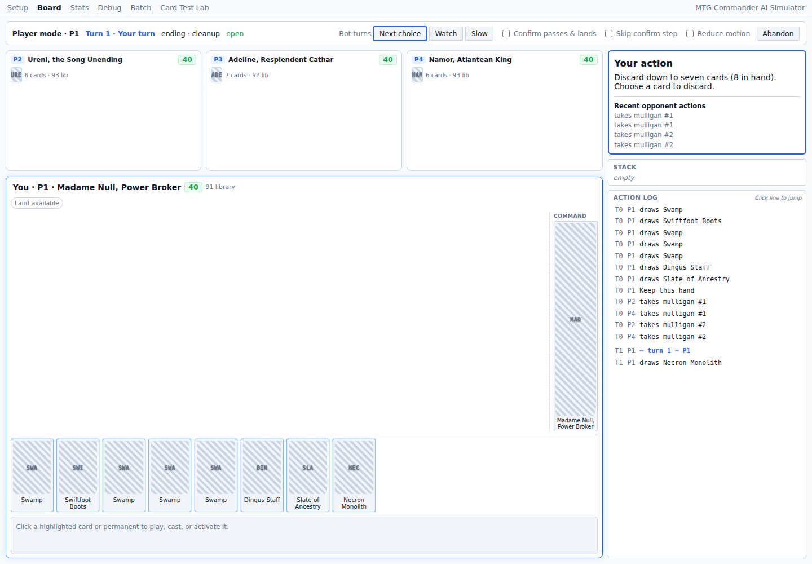
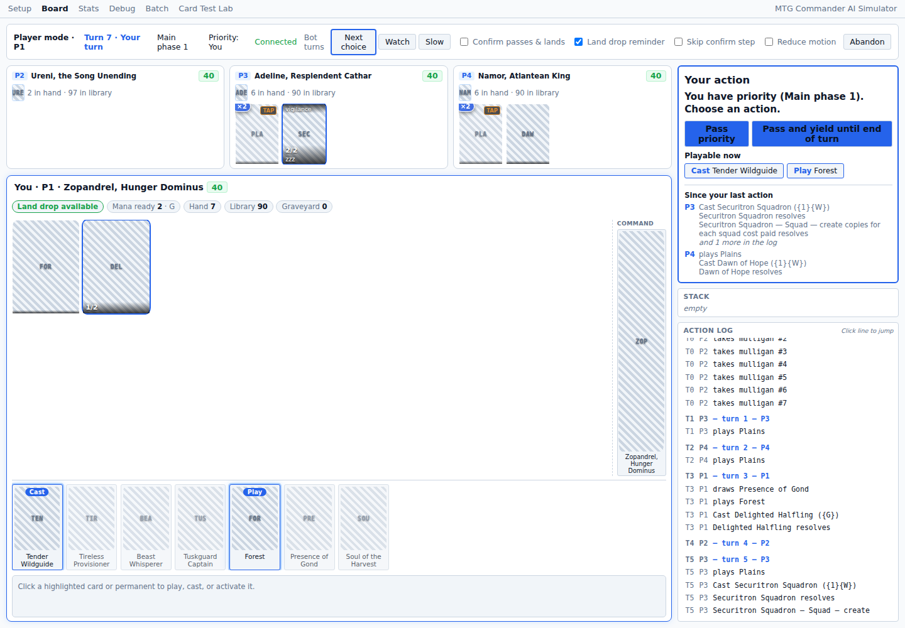
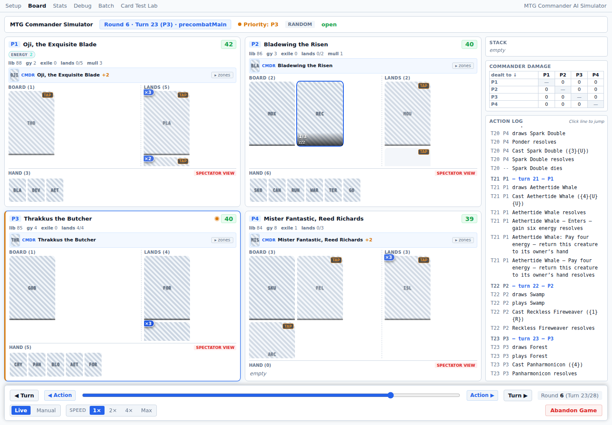
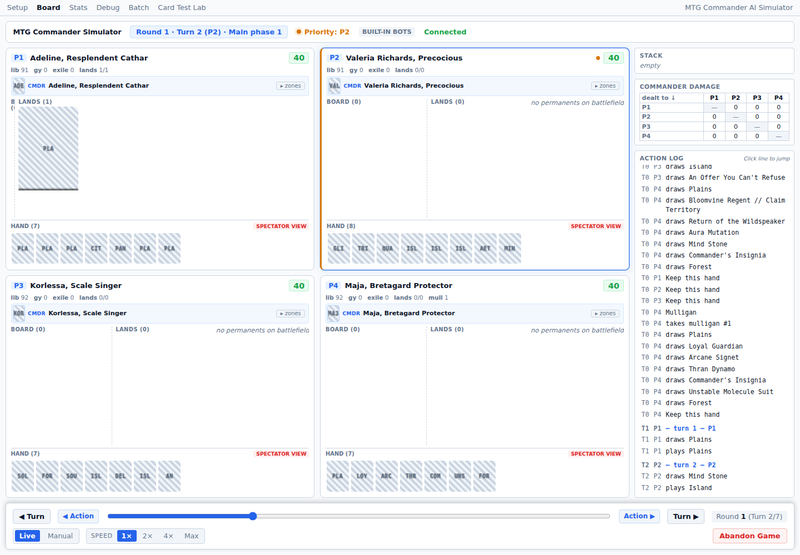

# UI polish - 2026-10-04

This review covers the UI polish work on branch `claude/adoring-gauss-6dt17h`: 28 commits on top of
`7d2e6e2`. It follows the [UI polish plan](../plans/ui-polish.md) (U1–U5 done, U6 deferred) and
closes most still-open findings from the
[2026-09-05 browser trial](browser-experience-2026-09-05.md). Screenshots are in
[`ui-polish-2026-10-04/`](ui-polish-2026-10-04/): `before-*` shots were taken on the starting commit,
and `after-*` shots on the final commit.

## How this was checked

- Live app at 1440×1000, driven with Playwright Chromium. Everything ran against a server started with
  `--oracle-fixture packages/server/fixtures/coverage-oracle.json`: the sandbox could not download
  the Scryfall bulk file, so the supported pool is the 604 cards that fixture yields.
- **Card art never loaded**, because Scryfall image hosts are unreachable from the sandbox. Every
  screenshot shows the initials placeholder. The new highlight, glow, and tags have not been looked at
  over real art.
- Final validation on the last commit: `bun run test` 2,924 passed, 29 skipped (the skipped suites
  need the bulk file, as in CI); `typecheck`, `typecheck:tests`, `lint`, `format:check`, the web build,
  `test:card-gate` (910), and `snapshots:check` all pass; `test:e2e` 86/86 and `test:e2e:setup` 2/2 pass
  with card art unreachable.

## What changed

### Player board

| Before                                                  | After                                                         |
| ------------------------------------------------------- | ------------------------------------------------------------- |
|  |  |

- **Playable cards are obvious.** Playable cards and permanents get an accent outline and glow, hand
  cards get a Play/Cast/Activate tag, and unplayable hand cards recede. A **Playable now** list in the
  action panel names each source the engine offers, grouping identical entries ("Play Forest ×2").
  Selecting an entry behaves exactly like clicking the card. See `after-03-playable-now.png`.
- **Land-drop reminder** (decided 2026-10-04). Passing, or passing and yielding, while the engine still
  offers a land play asks "You haven't played a land this turn": **Play a land** or **Pass anyway**.
  It asks once per turn, and the **Land drop reminder** setting turns it off.
  See `after-04-land-reminder.png`.
- **Resource strip** for your seat: land drop, Mana ready (with colors), floating mana, commander tax,
  hand, library, graveyard, and exile. Mana ready comes from a new engine projection,
  `PlayerBoardState.viewerMana`. It counts floating mana plus mana from sources that need no mana to
  activate and whose mana has no spending restriction, so it never claims more than is freely
  spendable.
- **Since your last action** groups what each opponent did since you last did something other than
  pass (latest three lines per seat), replacing four unlabeled lines such as "takes mulligan #1".
- **Layout.** Opponent panels size to their boards (capped at 40% of the height), and the active
  opponent's column is wider. The decision panel takes priority over the log, with a larger prompt.
- **Wording.** Turn positions read "Main phase 1" and "Combat · Declare blockers" instead of
  `precombatMain` and `combatDamage`. The priority prompt, connection state ("Connected"), auto-pay
  ("Forest ×2, Sol Ring" instead of "Forest ? Forest"), and elimination log lines ("— Life total
  reached 0") read in player terms. See `after-05-auto-pay.png`.
- **Abandon asks first** in player mode, sharing the spectator dialog (`after-08-abandon-confirm.png`).
  While any dialog is open, Space and Enter no longer reach the board shortcuts. Before this, Space
  on the dialog's focused button also passed priority.

### Starting a game

- A refused start no longer bounces silently. Setup used to navigate to the board before the server
  answered; a refusal bounced back after 1.5 s, cleared the preview and anything typed, and showed
  the reason only inside the collapsed Advanced setup. Both setup flows now wait for the server's
  answer and show any refusal beside the button (`after-07-refused-start.png`).
- **Player session lifecycle** (decided 2026-10-04: no takeover from another browser). A
  single-player game whose player has been disconnected for 30 minutes is abandoned, which frees the
  seat. A game that has finished, halted, or been abandoned no longer blocks a new start from
  another browser.
- **"Random bots" are labeled "Built-in bots".** That provider runs the seeded heuristic bot, not
  random choices.

### Spectator, statistics, and batches

| Before                                               | After                                                 |
| ---------------------------------------------------- | ----------------------------------------------------- |
|  |  |

- **"Who beats me" counts only genuine losses.** The runner recorded the last damaging seat for
  every player, including winners, decked players, and players hurt by their own spells. Now it
  records an eliminator only for a real loss to another seat, and the statistics queries apply the
  same rule to older rows without rewriting them (`after-11-stats.png`).
- Statistics show readable loss reasons and head unnamed decks with their commanders. Saved and
  imported decks come first, and generated decks fold into a collapsed section. One
  "Flood / drought: Unavailable" tile replaces two.
- Batch results show how far a failed or running game got ("stopped on 28", "35 so far") and why it
  failed. A game still running is no longer counted as processed and failed
  (`after-12a-batch-running.png`, `after-12-batch.png`).

## Tests and CI

- New regressions: refused-start handling, turn and prompt labels, the land reminder (including the
  Space-key guard), the idle-session timer and finished-game replacement, `eliminatorFor`, "Who beats
  me" against real SQLite with old row shapes, batch progress while a game runs, `viewerMana`
  (excluding costly and restricted sources), and the opponent-summary boundary.
- `apps/web/e2e/player-game.spec.ts` plays seed `e2e-6` against built-in bots: keep, the reminder, a
  land from Playable now, a spell paid by auto-pay, the summary on the next turn, Pass anyway, and
  abandon.
- `test:e2e:setup` now runs in CI. `serve --oracle-fixture` loads the committed Oracle fixture, so
  it no longer needs the gitignored bulk file.
- The Card Test Lab suite no longer depends on remote card art: three `getByAltText` assertions
  now match the placeholder's `role="img"` name.
- The two core-fast AI benchmark cases were re-pinned with `ai-bench refresh` after the engine change
  (pins only; snapshot content unchanged).

## Open issues

- **Fixed 2026-10-05: built-in-bot games could hang the server (pre-existing).** On the fixture
  card data, batch seed `14b47c00-80d` (blank seats, built-in bots) never finished game 2
  (`14b47c00-80d:s1:g2`), and because batches and live games run in the server process, HTTP and the
  WebSocket stopped responding. A CPU profile put the time in the mana-payment search
  (`solveFrom` in `packages/engine/src/mana/cost.ts`). On turn 41 the bot checked whether it could
  pay {23}{G} with twelve Treasures, a permanent with two mana abilities, and ten other green
  sources: one mana short. The search retried every dead end once per color of each any-color unit,
  which is exponential in the number of Treasures. It now remembers the states that failed. Only
  failures are cached, so every payment that was found before is found the same way: ten replayed
  games produce byte-identical message streams before and after. The game now finishes in 9 s, a
  48-game sweep found no other hang, and `mana.test.ts` covers the shape with seven Treasures, which
  took 1.8 s before (twelve never returned) and now take about 1 ms. The second hanging seed seen
  while choosing screenshots was not recorded, so it is covered only by that sweep. A runaway
  synchronous computation can still block the server; moving games off the server's event loop
  would be the safeguard, and is not done.
- **Narrow screens (U6) are deferred.** On a phone the player's hand is not shown at all
  (`deferred-phone-player.png`).
- **Not yet covered end to end:** combat from the player board, a full player game to victory,
  reconnection, and imports.
- **Still heuristic:** elimination credit goes to the last seat that dealt damage, so a life-loss
  effect after that damage is not seen.
- **Not seen with real art:** the new playable highlight needs a look over real card art.
